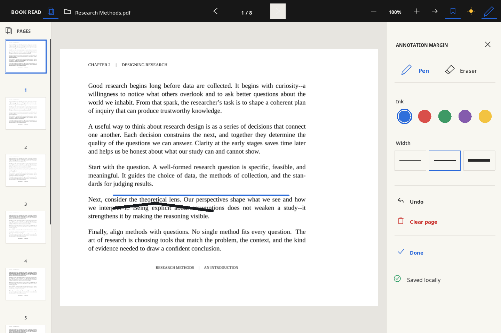
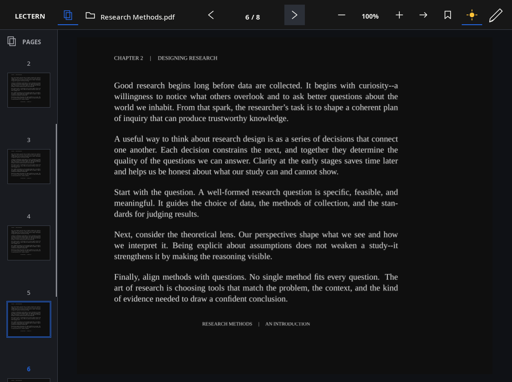
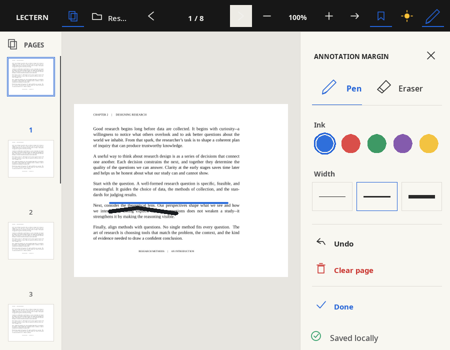

# Lectern

[](https://github.com/Osmait/lectern/actions/workflows/ci.yml)

A native Linux PDF reader written in Zig. It renders real PDF pages with
Poppler and Cairo and uses SDL3 for the desktop interface.



*Reading with the annotation margin open: pen and eraser tabs, ink swatches,
stroke widths, undo, clear, and the save indicator. The page rail on the left
previews every page.*

<p>


</p>

*Dark mode inverts the page and keeps ink readable; the layout holds every
control down to the minimum window size. The screenshots are produced by the
native test suite, so they always show the current interface.*

The reading state, the interface, and the application logic live in Zig. A
narrow C bridge exposes only rendering and input primitives, keeping the
macro-heavy SDL/Poppler headers away from Zig's C translator while still using
their native APIs directly; only the bridge's own small header is translated.

## Features

- Open PDFs with a file dialog, a command-line path, or drag and drop
- Automatically resume at the last page
- Add bookmarks and jump between them
- Dark and light reading modes, remembered across documents and launches
- A look you configure: themes that follow the desktop palette live, twelve
  built in, and your own, plus the font, corners, inks, and pen widths
- High-DPI text, vector icons, and pages rasterized at the size they are shown
- Pages rendered in the background: the neighbors of the current page are
  prepared ahead of time, so most page turns are instant and the window never
  freezes on a heavy page
- Page navigation and zoom that re-renders crisply once you pause
- A collapsible, scrollable thumbnail rail for previewing and jumping to pages
- Freehand PDF notes with pen and eraser tools
- Six ink colors, three pen sizes, per-page undo, and clear-page controls
- Annotation autosave without modifying the original PDF, written by a
  background thread so drawing never waits for the disk
- Mouse controls: clickable toolbar, page-edge clicks, and the scroll wheel
- An idle window costs no CPU: the reader sleeps until input, a timer, or a
  finished render wakes it
- Progress stored under `$XDG_STATE_HOME/lectern` or
  `~/.local/state/lectern`

## Supported platform

The current production target is Linux. The reading core and the interface are
platform independent, and native services are isolated so other desktop
backends can be added without rewriting reader behavior.

## Requirements

- Zig 0.17.x
- SDL3
- Poppler GLib
- Cairo

On Arch Linux / Omarchy:

```bash
sudo pacman -S zig sdl3 poppler-glib cairo
```

## Build and run

```bash
zig build
zig build run
```

You can also open a PDF directly:

```bash
zig build run -- /path/to/book.pdf
```

Install it for your user, with its desktop entry and icon:

```bash
./install.sh            # ~/.local/bin/lectern
./install.sh --default  # and make it the default PDF reader
```

Started without a path, the reader shows an empty desk and waits: press `O`,
click **Open**, or drop a PDF on the window. The file dialog never opens on
its own.

## Keyboard shortcuts

| Key | Action |
| --- | --- |
| `O` | Open a PDF |
| `Left` / `Page Up` / `<` | Previous page |
| `Right` / `Page Down` / `Space` / `>` | Next page |
| `B` | Toggle bookmark |
| `J` | Jump to the next bookmark |
| `D` | Toggle dark pages |
| `+` / `-` | Zoom in / out |
| `0` | Reset zoom |
| `Home` / `End` | First / last page |
| `P` | Toggle the pen |
| `E` | Toggle the eraser |
| `C` | Cycle the annotation color |
| `T` | Cycle the pen size |
| `U` | Undo the latest stroke on the current page |
| `X` | Clear annotations from the current page |
| `N` | Leave annotation mode |
| `S` | Show or hide the Pages rail |
| `Esc` | Quit |

You can also use the Pages icon in the top bar to show or hide the left rail,
click a page preview, click the **left or right quarter** of the reading area to
change pages, click the other toolbar controls, or use the mouse wheel.
Scrolling over the thumbnail rail browses the full page list without changing
the open page; scrolling over the document changes the current page. The
rail's scrollbar can be dragged with the mouse, and a click on its track
jumps there. Select
**PEN**, then hold the left mouse button and drag over the page to write.
Select **ERASE** and drag across a stroke to remove it.

The contextual annotation margin folds out beside the page. It provides five
direct color swatches, visual stroke-width buttons, pen and eraser tabs, undo,
clear, and a save indicator that also reports when notes could not be written.
Black remains available in the six-color keyboard cycle and is drawn as light
ink in dark mode. Selected tools and options use a highlighted state, while
buttons show hover feedback and vector icons. Keyboard shortcuts continue to
work alongside the visual controls. Your pen color and size stay selected when
you open another document.

Annotations use normalized page coordinates, so they stay aligned while the
window or page zoom changes. They are stored in a versioned sidecar file next
to the reading-state record and written a moment after each edit. The source
PDF is never changed. If a PDF is replaced by a revision with fewer pages, the
notes on the missing pages are skipped and the rest are kept.

## Make it yours

Everything is in `~/.config/lectern` (or `$XDG_CONFIG_HOME/lectern`) and is
reloaded the moment you save it. The first start writes a commented
`config.ini` and `themes/example.ini` to copy from.

| File | |
| --- | --- |
| `config.ini` | The theme, and anything you want to change on top of it |
| `themes/NAME.ini` | A theme of your own: three colors, plus optional style |

```ini
[general]
theme = auto          ; auto, lectern, a built-in name, or themes/NAME.ini

[view]
rail = true           ; open the page rail with every document

[style]
font = Noto Sans      ; the interface font; the PDF keeps its own
radius = 0            ; corners of hovers, selections, and buttons

[colors]              ; any color of the active theme, one by one
accent = #2363d8

[ink]                 ; blue red black yellow green purple black_on_dark
yellow = #f3c341

[pen]                 ; stroke widths in pixels
thin = 2
medium = 4
thick = 8
```

Every line is optional, and a value that cannot be read only costs its own
line: the reader says so on standard error and keeps the default.

### Themes

`theme = auto`, the default, follows the desktop. It reads
`~/.cache/rice/palette.json`, the palette the desktop's own panels use, and
takes the desktop's design system with it: the same surfaces, rules, and
accent, JetBrainsMono Nerd Font, and rounded chips for hovers and selections.
When the desktop switches theme the file is rewritten and Lectern repaints
with the new colors at once. Without that file `auto` is `lectern`, the paper
desk shown above.

The built-in themes are `lectern`, `catppuccin-mocha`, `catppuccin-latte`,
`dracula`, `nord`, `gruvbox-dark`, `gruvbox-light`, `tokyo-night`,
`rose-pine`, `one-dark`, `solarized-dark`, `solarized-light`, and `black`.

A theme of your own is a file in `themes`; `theme = midnight` reads
`themes/midnight.ini`:

```ini
[theme]
bg = #0f1117
fg = #e6e6e6
accent = #7c9cff

; optional: far muted canvas header header_text surface hover border
; danger success, and dark = true | false

[style]               ; optional, like [colors], [ink], and [pen]
font = JetBrainsMono Nerd Font
radius = 6
```

The colors a theme leaves out are worked out from the three it gives: raised
surfaces, hovers, and rules are `bg` tinted 5.5 %, 12 %, and 11 % toward
`far` (white on a dark theme). `config.ini` always wins over the theme.

`D` and the theme button switch the reading mode: light pages, or inverted
pages with light ink. Under `lectern` the chrome changes with it; every other
theme decides the chrome itself, so only the page changes.

## Stored files

Everything lives in the state directory:

| File | Contents |
| --- | --- |
| `preferences` | The reading theme |
| `<hash>.state` | Current page and bookmarks of one document |
| `<hash>.state.notes` | Annotations of one document |

Files are written atomically, so an interrupted save never damages the previous
version. State saved by earlier versions under `book-read` is moved to
`lectern` the first time the renamed reader starts. The `--smoke-test` mode uses a temporary directory instead and
deletes it afterwards, so it never touches these files.

## Development

Run every local quality gate with:

```bash
zig build ci --summary all
```

The application tests run on an in-memory backend and need no native library.
The native tests leave a screenshot of every interface surface in
`.zig-cache/screenshots` and compare each with its reference in
`tests/golden`; the end-to-end tests drive the real application with
synthetic input through SDL's dummy window.

See [CONTRIBUTING.md](CONTRIBUTING.md), [STYLE.md](STYLE.md), and the
[architecture guide](docs/architecture.md) for the project structure and
engineering conventions, and the [profiling guide](docs/profiling.md) for
the scripted session that feeds `perf` and flamegraphs. The [testing strategy](docs/testing.md) records the
happy-path, failure-path, and boundary coverage required for every module.
